# Tinycharts

Tinycharts draws a process as a hand-drawn statechart sheet that a person can click. A sheet is one HTML page. It has an isometric picture on cream paper, event buttons, a status line and a "Show the logic" panel. The panel lists the rules of the statechart, and a search of every path proves them.

The skill has 28 diagram types, for example timeline, flowchart, route map, decision tree and quadrant. Each type has an example sheet in `tinycharts/examples/`. You can export a sheet as SVG, PNG or an animated GIF.

> **Credit.** This project is a fan-made reverse-engineering of [tinycharts by April Zhu](https://april-zhu.com/tinycharts). We made it because we admire the original. The 28 diagram types, their questions and the look of the sheets come from that site. The code here is new, and it does not copy the JS of the original demos. To get the real thing, go to [april-zhu.com/tinycharts](https://april-zhu.com/tinycharts).

`tinycharts/SKILL.md` is the skill for Claude Code. `tinycharts/references/` has one guide for each type, plus `sheet.md` (the sheet contract) and `kit.md` (the drawing functions).

## Examples

Each GIF is a recording of Play all on the example sheet of one type. Open a sheet with `make.mjs` to click the buttons yourself. To record a GIF again, see [Commands](#commands).

<table>
<tr>
<td width="50%" valign="top"><a href="docs/gifs/timeline.gif">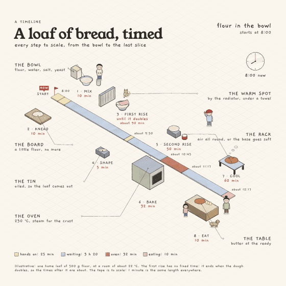</a><br><b>Timeline</b>: how long each step takes, to scale<br><a href="tinycharts/examples/timeline.js"><code>examples/timeline.js</code></a></td>
<td width="50%" valign="top"><a href="docs/gifs/parallel-timeline.gif">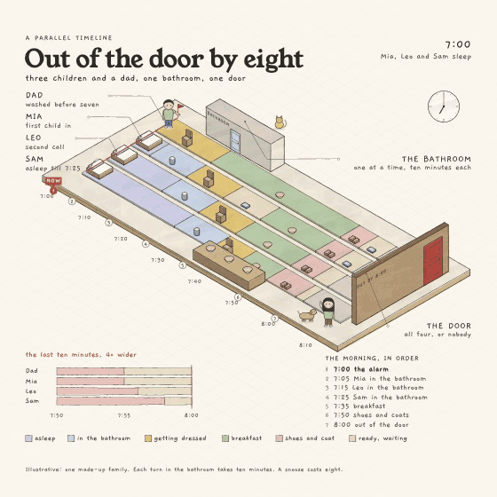</a><br><b>Parallel timeline</b>: jobs that run at once, and meet on time<br><a href="tinycharts/examples/parallel-timeline.js"><code>examples/parallel-timeline.js</code></a></td>
</tr>
<tr>
<td width="50%" valign="top"><a href="docs/gifs/clock.gif">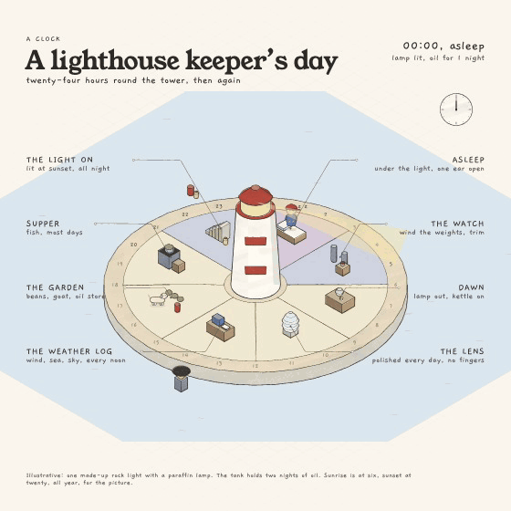</a><br><b>Clock</b>: a whole day, round once<br><a href="tinycharts/examples/clock.js"><code>examples/clock.js</code></a></td>
<td width="50%" valign="top"><a href="docs/gifs/time-lapse.gif">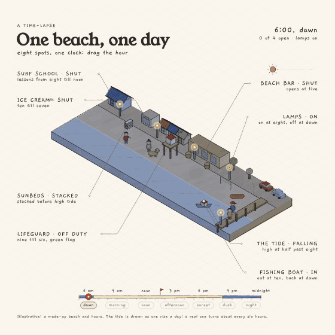</a><br><b>Time-lapse</b>: one place, changing through the day<br><a href="tinycharts/examples/time-lapse.js"><code>examples/time-lapse.js</code></a></td>
</tr>
<tr>
<td width="50%" valign="top"><a href="docs/gifs/timing-diagram.gif">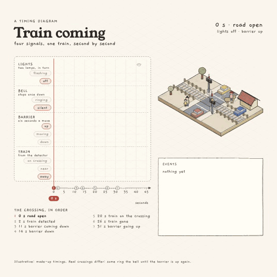</a><br><b>Timing diagram</b>: each signal, second by second<br><a href="tinycharts/examples/timing-diagram.js"><code>examples/timing-diagram.js</code></a></td>
<td width="50%" valign="top"><a href="docs/gifs/bands.gif">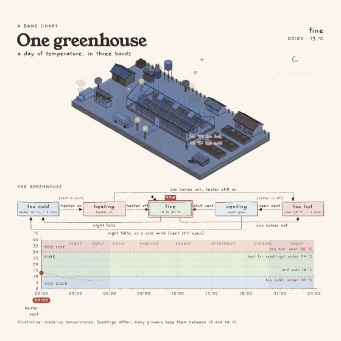</a><br><b>Bands</b>: which band a changing level is in<br><a href="tinycharts/examples/bands.js"><code>examples/bands.js</code></a></td>
</tr>
<tr>
<td width="50%" valign="top"><a href="docs/gifs/exploded-view.gif">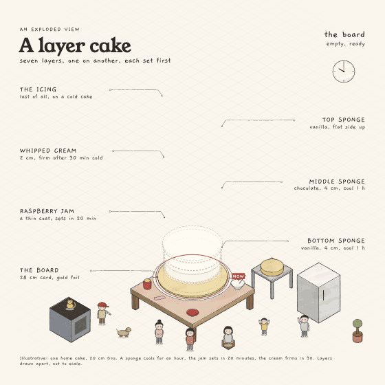</a><br><b>Exploded view</b>: what is inside, layer by layer<br><a href="tinycharts/examples/exploded-view.js"><code>examples/exploded-view.js</code></a></td>
<td width="50%" valign="top"><a href="docs/gifs/annotated-scene.gif">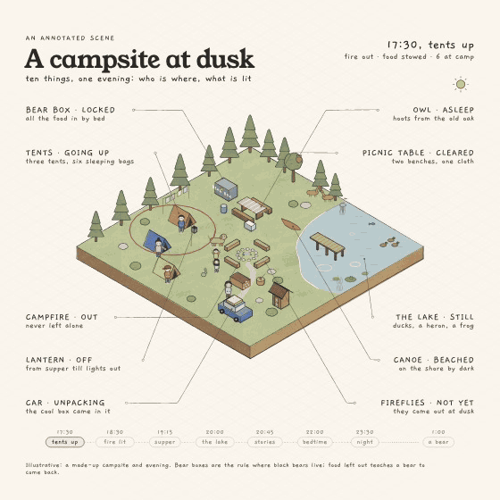</a><br><b>Annotated scene</b>: everything happening in one place<br><a href="tinycharts/examples/annotated-scene.js"><code>examples/annotated-scene.js</code></a></td>
</tr>
<tr>
<td width="50%" valign="top"><a href="docs/gifs/zoom.gif">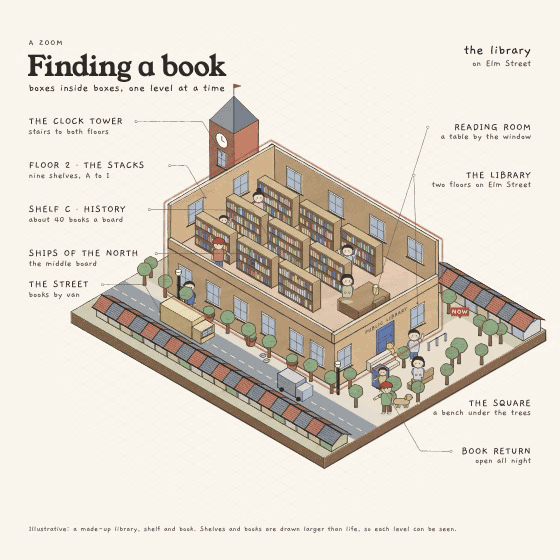</a><br><b>Zoom</b>: where it is, from the big picture down<br><a href="tinycharts/examples/zoom.js"><code>examples/zoom.js</code></a></td>
<td width="50%" valign="top"><a href="docs/gifs/route-map.gif">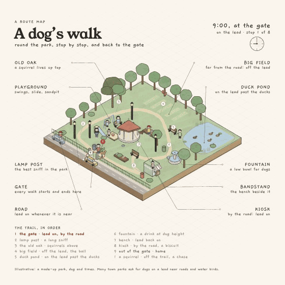</a><br><b>Route map</b>: where it went, stop by stop<br><a href="tinycharts/examples/route-map.js"><code>examples/route-map.js</code></a></td>
</tr>
<tr>
<td width="50%" valign="top"><a href="docs/gifs/bubble-diagram.gif">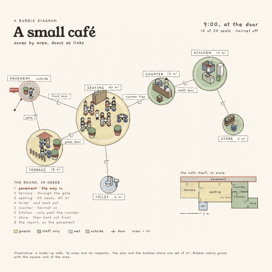</a><br><b>Bubble diagram</b>: which spaces connect, and how big<br><a href="tinycharts/examples/bubble-diagram.js"><code>examples/bubble-diagram.js</code></a></td>
<td width="50%" valign="top"><a href="docs/gifs/flowchart.gif">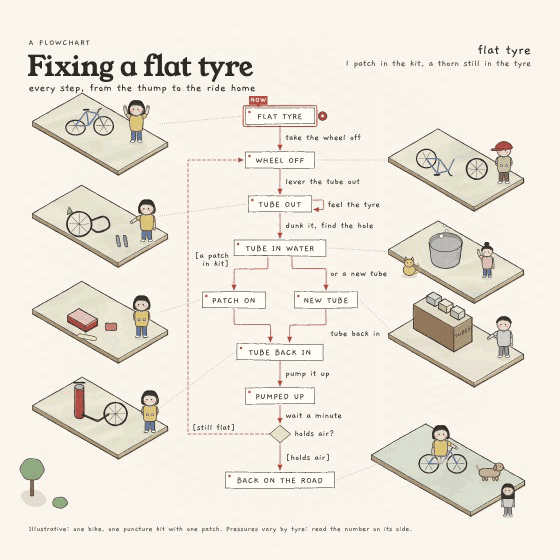</a><br><b>Flowchart</b>: every step, and where it splits<br><a href="tinycharts/examples/flowchart.js"><code>examples/flowchart.js</code></a></td>
</tr>
<tr>
<td width="50%" valign="top"><a href="docs/gifs/decision-tree.gif">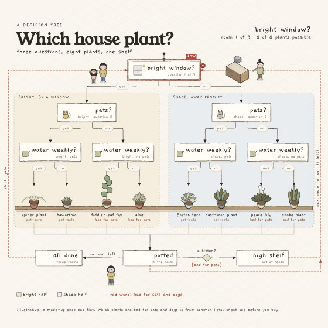</a><br><b>Decision tree</b>: every answer, and every outcome in view<br><a href="tinycharts/examples/decision-tree.js"><code>examples/decision-tree.js</code></a></td>
<td width="50%" valign="top"><a href="docs/gifs/comic-strip.gif">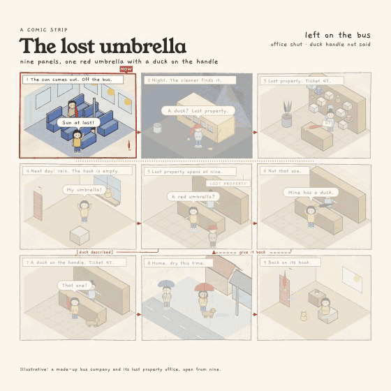</a><br><b>Comic strip</b>: a story, one panel at a time<br><a href="tinycharts/examples/comic-strip.js"><code>examples/comic-strip.js</code></a></td>
</tr>
<tr>
<td width="50%" valign="top"><a href="docs/gifs/cycle.gif">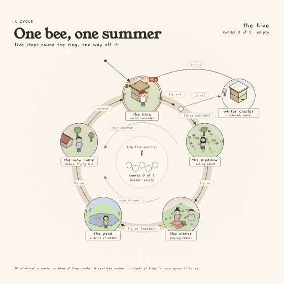</a><br><b>Cycle</b>: a loop, and the one way off it<br><a href="tinycharts/examples/cycle.js"><code>examples/cycle.js</code></a></td>
<td width="50%" valign="top"><a href="docs/gifs/flow-machine.gif">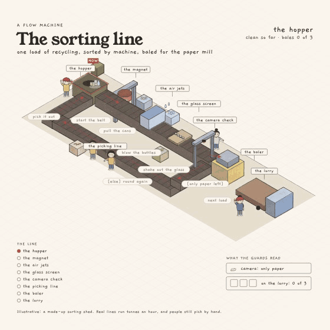</a><br><b>Flow machine</b>: a process built as a machine<br><a href="tinycharts/examples/flow-machine.js"><code>examples/flow-machine.js</code></a></td>
</tr>
<tr>
<td width="50%" valign="top"><a href="docs/gifs/kanban.gif">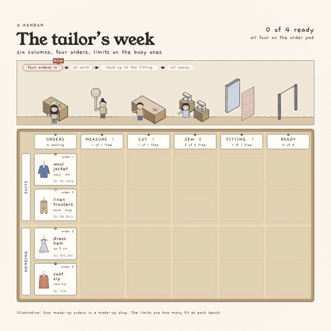</a><br><b>Kanban</b>: where each item is, and what is held up<br><a href="tinycharts/examples/kanban.js"><code>examples/kanban.js</code></a></td>
<td width="50%" valign="top"><a href="docs/gifs/game-board.gif">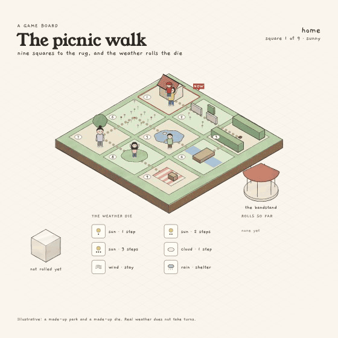</a><br><b>Game board</b>: what chance decides<br><a href="tinycharts/examples/game-board.js"><code>examples/game-board.js</code></a></td>
</tr>
<tr>
<td width="50%" valign="top"><a href="docs/gifs/sankey.gif">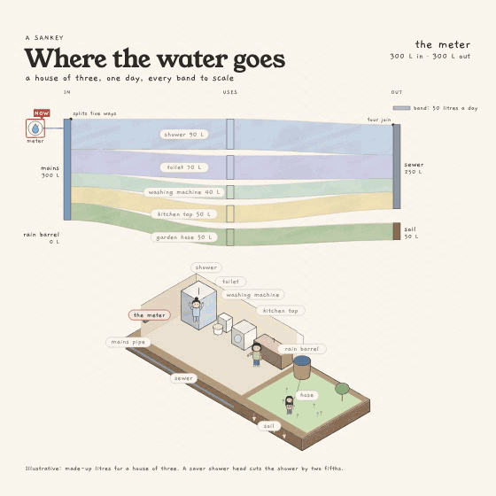</a><br><b>Sankey</b>: where it all goes, and how much<br><a href="tinycharts/examples/sankey.js"><code>examples/sankey.js</code></a></td>
<td width="50%" valign="top"><a href="docs/gifs/funnel.gif">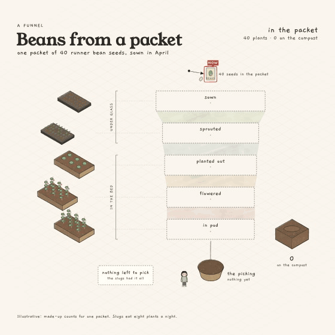</a><br><b>Funnel</b>: how many make it through each stage<br><a href="tinycharts/examples/funnel.js"><code>examples/funnel.js</code></a></td>
</tr>
<tr>
<td width="50%" valign="top"><a href="docs/gifs/stock-and-flow.gif">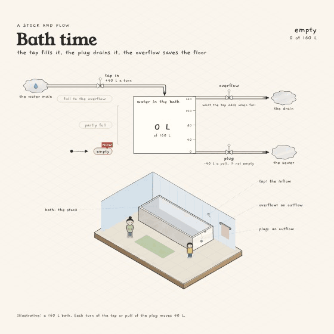</a><br><b>Stock and flow</b>: what fills it, and what drains it<br><a href="tinycharts/examples/stock-and-flow.js"><code>examples/stock-and-flow.js</code></a></td>
<td width="50%" valign="top"><a href="docs/gifs/sequence.gif">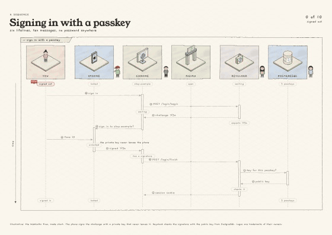</a><br><b>Sequence</b>: who says what to whom, in order<br><a href="tinycharts/examples/sequence.js"><code>examples/sequence.js</code></a></td>
</tr>
<tr>
<td width="50%" valign="top"><a href="docs/gifs/network.gif">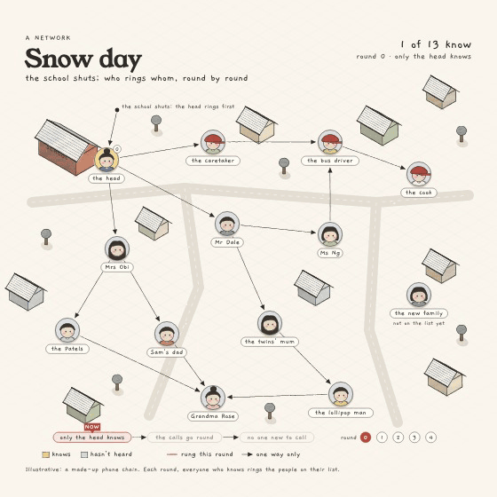</a><br><b>Network</b>: who reaches whom<br><a href="tinycharts/examples/network.js"><code>examples/network.js</code></a></td>
<td width="50%" valign="top"><a href="docs/gifs/fishbone.gif">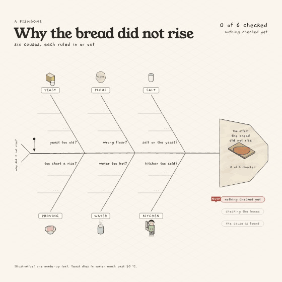</a><br><b>Fishbone</b>: which causes are ruled in or out<br><a href="tinycharts/examples/fishbone.js"><code>examples/fishbone.js</code></a></td>
</tr>
<tr>
<td width="50%" valign="top"><a href="docs/gifs/escalation.gif">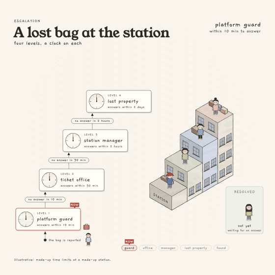</a><br><b>Escalation</b>: who takes it next, if no one answers<br><a href="tinycharts/examples/escalation.js"><code>examples/escalation.js</code></a></td>
<td width="50%" valign="top"><a href="docs/gifs/catalogue.gif">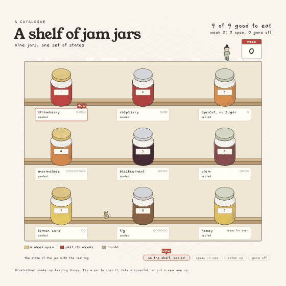</a><br><b>Catalogue</b>: one set of states, many at once<br><a href="tinycharts/examples/catalogue.js"><code>examples/catalogue.js</code></a></td>
</tr>
<tr>
<td width="50%" valign="top"><a href="docs/gifs/break-even.gif">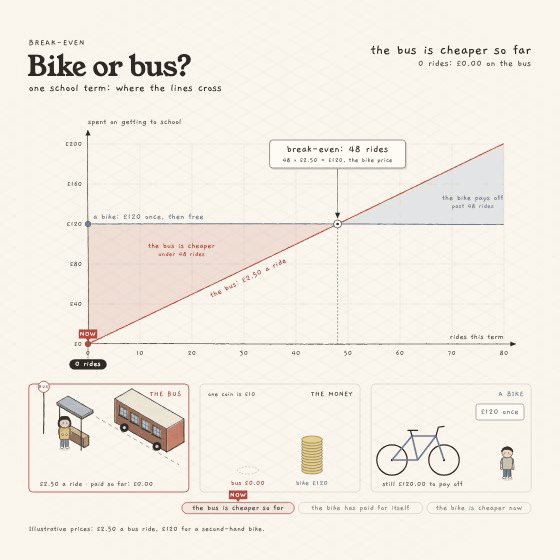</a><br><b>Break-even</b>: the point where one option wins<br><a href="tinycharts/examples/break-even.js"><code>examples/break-even.js</code></a></td>
<td width="50%" valign="top"><a href="docs/gifs/quadrant.gif">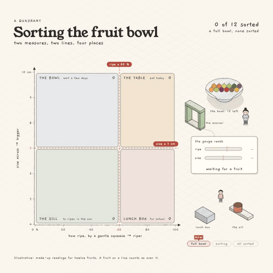</a><br><b>Quadrant</b>: where each one falls on two measures<br><a href="tinycharts/examples/quadrant.js"><code>examples/quadrant.js</code></a></td>
</tr>
</table>

## Requirements

- [Bun](https://bun.sh) 1.1 or later. All commands use Bun.
- Google Chrome or Chromium. The checks, the exports and the GIF recorder use headless Chrome. If Chrome is not in a usual place, set `CHROME` to its path.
- [ffmpeg](https://ffmpeg.org), only for GIF files. On macOS: `brew install ffmpeg`.

## Setup

```bash
git clone <this repo> tinycharts
cd tinycharts
bun install
bun test
```

Run every command from the repo root. Temporary files go in `.tmp/`, which git ignores.

### Use it as a Claude Code skill

Link the skill folder into your skills folder:

```bash
ln -s "$PWD/tinycharts" ~/.claude/skills/tinycharts
```

Then ask Claude Code for a diagram, for example "show how a pull request gets merged, as a tinycharts sheet".

## Commands

| Task | Command |
|---|---|
| See all 28 example sheets on one page | `bun scripts/gallery.mjs -o .tmp/all.html` |
| Start a new sheet from the template of a type | `bun tinycharts/build/new.mjs <type> <dir>/<name>` |
| Check a sheet, build its page and audit every state | `bun tinycharts/build/make.mjs <dir>/<name>.js -o <dir>/<name>.html [--png <dir>/png]` |
| Build a page only, with no checks | `bun tinycharts/build/build.mjs <a>.js [<b>.js ...] -o <page>.html [--logic]` |
| Export SVG and PNG files | `bun tinycharts/build/export.mjs <page>.html [--state <id> \| --story] [--svg] [--png] -o <dir>` |
| Record Play all as a GIF | `bun tinycharts/build/gif.mjs <page>.html [--width 560] [--fps 10] -o <name>.gif` |
| Record the README GIFs again | `bun scripts/gifs.mjs [slug...]` (no slug: all 28 examples, into `docs/gifs/`) |
| Fetch a technology logo | `bun tinycharts/build/logos.mjs <key...>` |
| Run the tests | `bun test` |

Open a page in a browser. `<page>.html#state=<id>` opens one state.

### Examples

```bash
bun tinycharts/build/make.mjs tinycharts/examples/route-map.js -o .tmp/route-map.html --png .tmp/png
```

```bash
bun tinycharts/build/gif.mjs .tmp/route-map.html -o .tmp/route-map.gif
```

On a page with more than one sheet, add `--sheet <key>` to `export.mjs` and `gif.mjs`.

## How the GIF recorder works

`gif.mjs` opens the page in headless Chrome through the DevTools protocol. It hides the side panel, keeps the whole sheet in view (the camera does not zoom), presses Play all, and records the sheet until the story ends. Then ffmpeg makes the GIF with one palette for all frames. The recorder stops after `--max` seconds (default 180) if the story does not end.

## Layout

```
tinycharts/          the skill
  SKILL.md           instructions for Claude Code
  kit/               the drawing functions (pen, solids, people, text, motion)
  shell/             the page: buttons, camera, status, logic panel
  build/             the command-line tools
  examples/          one example sheet for each type: .js, .mmd statechart, .check.mjs
  references/        one guide for each type, the sheet contract and the kit
  fonts/, icons/     fonts (SIL OFL) and technology logos
tests/               bun tests
scripts/             helper scripts that are not part of the skill
docs/specs/          the design specification
```

## Licence

The code of this repository is under the [PolyForm Noncommercial License 1.0.0](LICENSE). You can use, change and share it for any noncommercial purpose. You cannot use it for a commercial purpose.

`tinycharts/NOTICE.md` lists the third-party parts and their licences. Those parts keep their own licences.
